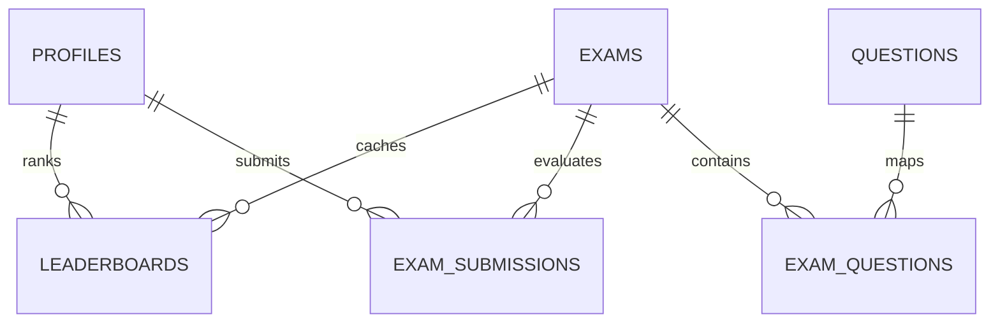

# TargetAce: Backend & Supabase Database Reference

---

## 🗄️ 1. Database Schema & Architecture

TargetAce utilizes **Supabase (PostgreSQL 15+)** with Row Level Security (RLS) enabled across all public tables.



### Table Definitions & Column Constraints

#### 1. `public.profiles`
Stores extended user profile information linked to Supabase `auth.users(id)`.
- `id` (`UUID`, Primary Key, REFERENCES `auth.users(id)`)
- `name` (`TEXT`, NOT NULL)
- `email` (`TEXT`, NOT NULL)
- `phone` (`TEXT`)
- `gender` (`TEXT`)
- `dob` (`DATE`)
- `avatar_url` (`TEXT`)
- `institution` (`TEXT`)
- `district` (`TEXT`)
- `goal` (`TEXT`, e.g. `'bcs'`)
- `group_id` (`UUID`, REFERENCES `public.groups(id)`)
- `created_at` (`TIMESTAMPTZ`, DEFAULT `NOW()`)

#### 2. `public.exams`
Master exam configuration and schedules.
- `id` (`UUID`, Primary Key, DEFAULT `gen_random_uuid()`)
- `title` (`TEXT`, NOT NULL)
- `goal_id` (`TEXT`, NOT NULL)
- `group_id` (`UUID`, NOT NULL)
- `start_time` (`TIMESTAMPTZ`, NOT NULL)
- `end_time` (`TIMESTAMPTZ`, NOT NULL)
- `duration_minutes` (`INT`, NOT NULL, DEFAULT `30`)
- `total_questions` (`INT`, NOT NULL, DEFAULT `10`)
- `per_question_mark` (`NUMERIC(5,2)`, NOT NULL, DEFAULT `1.0`)
- `negative_mark` (`NUMERIC(5,2)`, NOT NULL, DEFAULT `0.25`)
- `is_published` (`BOOLEAN`, DEFAULT `TRUE`)

#### 3. `public.questions`
Authoritative master question bank.
- `id` (`UUID`, Primary Key, DEFAULT `gen_random_uuid()`)
- `question_text` (`TEXT`, NOT NULL)
- `option_a` (`TEXT`, NOT NULL)
- `option_b` (`TEXT`, NOT NULL)
- `option_c` (`TEXT`, NOT NULL)
- `option_d` (`TEXT`, NOT NULL)
- `correct_option` (`TEXT`, NOT NULL) -- 'A', 'B', 'C', or 'D'
- `explanation` (`TEXT`)
- `subject_id` (`UUID`)
- `topic_id` (`UUID`)
- `difficulty_level` (`INT`, DEFAULT `1`)

#### 4. `public.exam_submissions`
Logs all submitted exam attempts.
- `id` (`UUID`, Primary Key, DEFAULT `gen_random_uuid()`)
- `exam_id` (`UUID`, NOT NULL, REFERENCES `public.exams(id)`)
- `user_id` (`UUID`, NOT NULL, REFERENCES `public.profiles(id)`)
- `score` (`NUMERIC(5,2)`, NOT NULL, DEFAULT `0.0`)
- `correct_count` (`INT`, NOT NULL, DEFAULT `0`)
- `wrong_count` (`INT`, NOT NULL, DEFAULT `0`)
- `unanswered_count` (`INT`, NOT NULL, DEFAULT `0`)
- `answers` (`JSONB`, NOT NULL, DEFAULT `'[]'::jsonb`)
- `disqualified` (`BOOLEAN`, NOT NULL, DEFAULT `FALSE`)
- `is_auto_submitted` (`BOOLEAN`, DEFAULT `FALSE`)
- `started_at` (`TIMESTAMPTZ`)
- `completed_at` (`TIMESTAMPTZ`, DEFAULT `NOW()`)
- `time_taken_seconds` (`INT`, DEFAULT `0`)
- `device_info` (`JSONB`, DEFAULT `'{}'::jsonb`)
- `app_version` (`TEXT`)

#### 5. `public.leaderboards` (Performance Ranking Cache Table)
Dedicated cache table populated by database triggers to accelerate real-time ranking.
- `id` (`UUID`, Primary Key, DEFAULT `gen_random_uuid()`)
- `exam_id` (`UUID`, NOT NULL, REFERENCES `public.exams(id)`)
- `user_id` (`UUID`, NOT NULL, REFERENCES `public.profiles(id)`)
- `score` (`NUMERIC(5,2)`, NOT NULL, DEFAULT `0.0`)
- `time_taken_seconds` (`INT`, NOT NULL, DEFAULT `0`)
- `rank` (`INT`, NOT NULL, DEFAULT `0`)
- `updated_at` (`TIMESTAMPTZ`, DEFAULT `NOW()`)
- **Indexes**: `idx_leaderboards_rank (exam_id, rank ASC)`, `idx_leaderboards_user (user_id)`
- **Constraint**: `UNIQUE (exam_id, user_id)`

---

## 🔒 2. PostgreSQL Security & Server RPCs

### 1. `submit_battle_exam_secure` (RPC)
Defined in `supabase/migrations/20260731000000_submit_battle_exam_secure.sql`.

```sql
CREATE OR REPLACE FUNCTION public.submit_battle_exam_secure(
    p_exam_id UUID,
    p_user_id UUID,
    p_answers JSONB,
    p_disqualified BOOLEAN DEFAULT FALSE,
    p_started_at TIMESTAMPTZ DEFAULT NULL,
    p_completed_at TIMESTAMPTZ DEFAULT NULL,
    p_time_taken_seconds INT DEFAULT 0,
    p_device_info JSONB DEFAULT '{}'::jsonb,
    p_app_version TEXT DEFAULT NULL,
    p_is_auto_submitted BOOLEAN DEFAULT FALSE
)
RETURNS JSONB AS $$
DECLARE
    v_per_question_mark NUMERIC(5,2) := 1.0;
    v_negative_mark NUMERIC(5,2) := 0.25;
    v_correct_count INT := 0;
    v_wrong_count INT := 0;
    v_unanswered_count INT := 0;
    v_total_questions INT := 0;
    v_raw_score NUMERIC(5,2) := 0.0;
    v_max_score NUMERIC(5,2) := 0.0;
    v_final_score NUMERIC(5,2) := 0.0;
    v_processed_answers JSONB := '[]'::jsonb;
    v_submission_record public.exam_submissions%ROWTYPE;
BEGIN
    -- Fetch per question mark and negative mark settings
    SELECT COALESCE(per_question_mark, 1.0), COALESCE(negative_mark, 0.25)
    INTO v_per_question_mark, v_negative_mark
    FROM public.exams WHERE id = p_exam_id;

    -- Compute evaluations against authoritative questions table
    WITH exam_q AS (
        SELECT q.id AS question_id, q.correct_option
        FROM public.questions q
        JOIN public.exam_questions eq ON eq.question_id = q.id
        WHERE eq.exam_id = p_exam_id
    ),
    client_ans AS (
        SELECT 
            (elem->>'question_id')::UUID AS question_id,
            COALESCE(elem->>'selected', '') AS selected
        FROM jsonb_array_elements(COALESCE(p_answers, '[]'::jsonb)) AS elem
    ),
    eval AS (
        SELECT 
            eq.question_id,
            eq.correct_option,
            COALESCE(ca.selected, '') AS selected,
            CASE 
                WHEN ca.selected IS NULL OR ca.selected = '' THEN 'unanswered'
                WHEN UPPER(TRIM(ca.selected)) = UPPER(TRIM(eq.correct_option)) THEN 'correct'
                ELSE 'wrong'
            END AS eval_status
        FROM exam_q eq
        LEFT JOIN client_ans ca ON ca.question_id = eq.question_id
    )
    SELECT 
        COUNT(*),
        COUNT(*) FILTER (WHERE eval_status = 'correct'),
        COUNT(*) FILTER (WHERE eval_status = 'wrong'),
        COUNT(*) FILTER (WHERE eval_status = 'unanswered'),
        COALESCE(jsonb_agg(jsonb_build_object(
            'question_id', question_id,
            'selected', selected,
            'correct', correct_option,
            'is_correct', (eval_status = 'correct')
        )), '[]'::jsonb)
    INTO v_total_questions, v_correct_count, v_wrong_count, v_unanswered_count, v_processed_answers
    FROM eval;

    -- Calculate score percentage with floor 0.0% and ceiling 100.0%
    v_raw_score := (v_correct_count * v_per_question_mark) - (v_wrong_count * v_negative_mark);
    v_max_score := v_total_questions * v_per_question_mark;

    IF p_disqualified THEN
        v_final_score := 0.0;
    ELSIF v_max_score > 0 THEN
        v_final_score := LEAST(GREATEST(((v_raw_score / v_max_score) * 100.0), 0.0), 100.0);
    ELSE
        v_final_score := 0.0;
    END IF;

    -- Upsert submission
    INSERT INTO public.exam_submissions (
        exam_id, user_id, score, correct_count, wrong_count, unanswered_count,
        answers, disqualified, is_auto_submitted, started_at, completed_at,
        time_taken_seconds, device_info, app_version
    ) VALUES (
        p_exam_id, p_user_id, v_final_score, v_correct_count, v_wrong_count, v_unanswered_count,
        COALESCE(v_processed_answers, '[]'::jsonb), p_disqualified, p_is_auto_submitted,
        p_started_at, COALESCE(p_completed_at, NOW()), p_time_taken_seconds, p_device_info, p_app_version
    )
    ON CONFLICT (exam_id, user_id) DO UPDATE SET
        score = EXCLUDED.score,
        correct_count = EXCLUDED.correct_count,
        wrong_count = EXCLUDED.wrong_count,
        unanswered_count = EXCLUDED.unanswered_count,
        answers = EXCLUDED.answers,
        disqualified = EXCLUDED.disqualified,
        is_auto_submitted = EXCLUDED.is_auto_submitted,
        completed_at = EXCLUDED.completed_at,
        time_taken_seconds = EXCLUDED.time_taken_seconds
    RETURNING * INTO v_submission_record;

    RETURN row_to_json(v_submission_record)::jsonb;
END;
$$ LANGUAGE plpgsql SECURITY DEFINER;
```

---

## ⚡ 3. Real-Time Triggers

### `on_submission_leaderboard_sync`
- Trigger Definition:
  ```sql
  CREATE TRIGGER on_submission_leaderboard_sync
      AFTER INSERT OR UPDATE OF score ON public.exam_submissions
      FOR EACH ROW EXECUTE FUNCTION public.sync_exam_leaderboard();
  ```
- Function Definition:
  ```sql
  CREATE OR REPLACE FUNCTION public.sync_exam_leaderboard()
  RETURNS TRIGGER AS $$
  BEGIN
      INSERT INTO public.leaderboards (exam_id, user_id, score, time_taken_seconds, rank, updated_at)
      VALUES (NEW.exam_id, NEW.user_id, NEW.score, COALESCE(NEW.time_taken_seconds, 0), 0, NOW())
      ON CONFLICT (exam_id, user_id) DO UPDATE SET
          score = EXCLUDED.score,
          time_taken_seconds = EXCLUDED.time_taken_seconds,
          updated_at = NOW();
      RETURN NEW;
  END;
  $$ LANGUAGE plpgsql SECURITY DEFINER;
  ```
