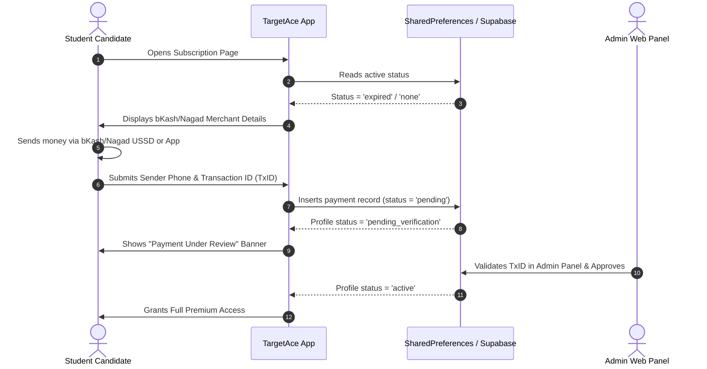
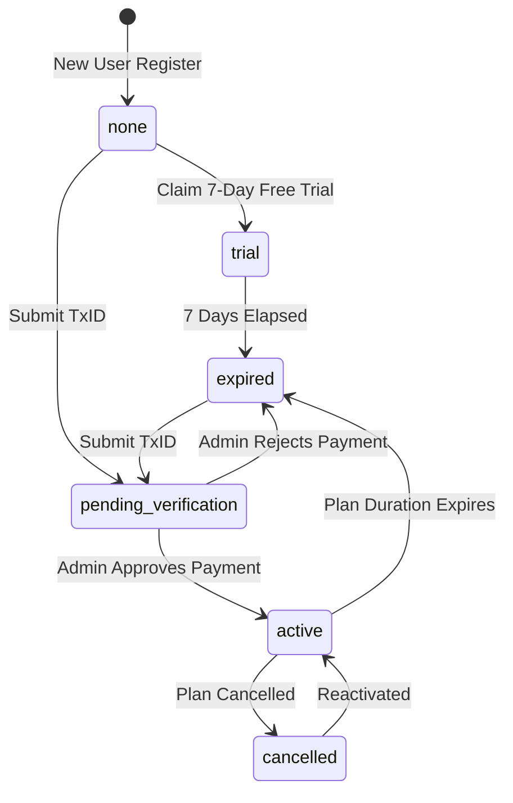

# TargetAce: Business Model, Subscriptions & Monetization

---

## 💼 1. Monetization Strategy

TargetAce employs a **Freemium & Micro-Subscription Model** optimized for Bangladeshi students:

| Feature / Access Tier | Free Tier | Premium Tier (BDT 50–100 / mo) |
| :--- | :---: | :---: |
| **Daily 9:00 PM Live Battle Exam** | ✅ Included (1/day) | ✅ Included |
| **Instant Score & Percentile** | ✅ Included | ✅ Included |
| **National Rank (Global/Group)** | ❌ Limited | ✅ Full Access |
| **3D Podium Display** | ❌ Masked | ✅ Full Access |
| **Detailed Question Explanations** | ❌ Locked | ✅ Full Access |
| **Practice Hub (Subject/Topic Quizzes)** | ❌ Restricted | ✅ Unlimited Access |
| **Bookmarking & Error Reporting** | ✅ Included | ✅ Included |

---

## 💳 2. Payment Flow & Mobile Banking Integration

TargetAce natively accommodates Bangladesh's Mobile Financial Services (MFS)—**bKash** and **Nagad**:



---

## 🔄 3. Subscription Status Lifecycles

The subscription lifecycle manages all candidate states within `UserLocalDataSource` and `profiles`:



### Complete Status Code Table

| Status String | UI Header Text | Main Button Action | Navigation Target |
| :--- | :--- | :--- | :--- |
| `'trial'` | Active Trial | Enter Live Arena | Home Arena (`/dashboard`) |
| `'active'` | Premium Active | Enter Live Arena | Home Arena (`/dashboard`) |
| `'pending_verification'` | Payment Under Review | Check Verification Status | Stay on Activation Page |
| `'pending'` | Payment Under Review | Check Verification Status | Stay on Activation Page |
| `'expired'` | Renew Your Subscription | Renew Subscription on Website | Launch External Website |
| `'cancelled'` | Reactivate Plan | Reactivate Plan on Website | Launch External Website |
| `'none'` | Premium Access | Visit Website to Subscribe | Launch External Website |

---

## 💬 4. WhatsApp Pre-Filled Support Protocol

If a candidate experiences payment issues or verification delays, clicking "Contact Support" on the activation page or error widget launches WhatsApp with pre-formatted diagnostic telemetry:

```dart
final message = '''
Assalamu Alaikum,

I am using TargetAce app. I need help regarding my subscription / account.

• Name: $userName
• User ID: $userId
• Plan: ${plan.isNotEmpty ? plan : 'No Active Plan'}
• App Version: ${AppConfig.appVersion}

My issue:
(Please write here)

Thank you.
''';
```
- **Generated Link**: `https://wa.me/8801700000000?text=<ENCODED_URI_COMPONENT>`
