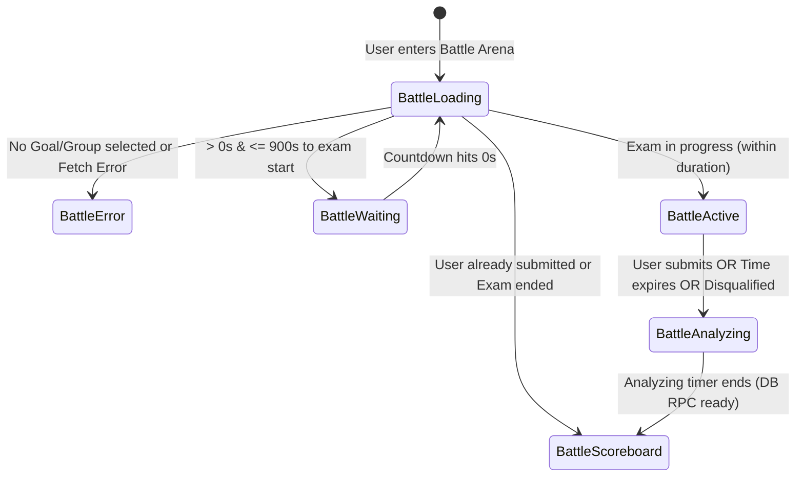
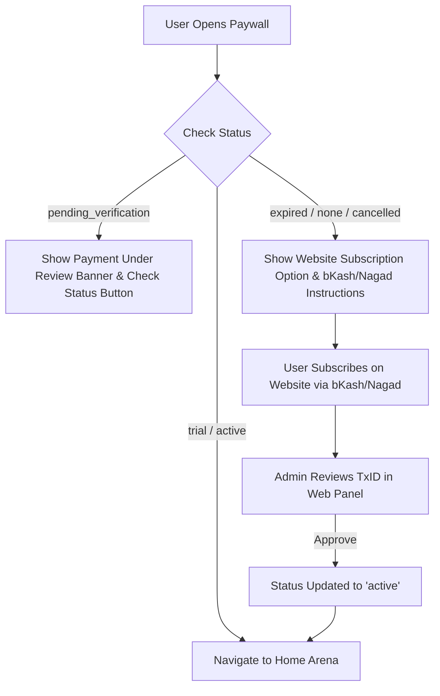

# TargetAce: Features & Detailed Specifications

---

## ⚔️ 1. Live Battle Engine (`lib/features/battle`)

The Live Battle Engine is TargetAce's core real-time competitive module.



### Detailed Lifecycle States & Rules

#### 1. Waiting Room (`BattleWaiting`)
- **Opening Time**: Opens exactly **15 minutes (900 seconds)** prior to `startTime`.
- **Pre-waiting Guard**: If a user attempts to enter >15 minutes early, an informative banner displays: `"Tonight's live battle starts at [hh:mm a]. The waiting room opens 15 minutes before the start."`
- **Real-Time Countdown**: Ticks synchronously every 1 second. When `waitingSecondsRemaining == 0`, BLoC automatically re-triggers `BattleLoadRequested()` to load the exam page without user intervention.

#### 2. Active Exam Room (`BattleActive`)
- **UTC Server Synchronization**: Exam duration is computed relative to server UTC timestamps:
  `elapsedSeconds = nowUtc.difference(startTimeUtc).inSeconds`
  `questionSecondsRemaining = (durationMinutes * 60) - elapsedSeconds`
- **In-Memory Answer Buffer**: User selections are buffered locally in BLoC state `userAnswersList` as structured JSON maps:
  `{'question_id': '...', 'selected': 'B', 'correct': 'A', 'is_correct': false, 'status': 'answered'}`
- **Question Navigation**: Jump to any question by index via `BattleQuestionJumped`. Answers are preserved across jumps.

#### 3. Analyzing & Verification (`BattleAnalyzing`)
- **Duration**: Dynamic duration calculated as `(examEndTime - now) + 10s` (Minimum 10 seconds).
- **Function**: Displays a loading/analyzing animation while background async calls invoke the PostgreSQL RPC `submit_battle_exam_secure`.
- **Instant Client Score Preview**: Instantly calculates and displays raw score percentage using `BattleScoreCalculator` while waiting for DB confirmation.

#### 4. Scoreboard & Podium (`BattleScoreboard`)
- **3D Podium**: Top 3 performers (1st, 2nd, 3rd) rendered with gold, silver, and bronze badges.
- **Rank Breakdown**: Displays **Exam Rank**, **Group Rank**, and **Global Rank**.
- **Review Mode**: Allows candidates to review all exam questions, correct option keys, and explanations.

---

## 🛡️ 2. Anti-Cheat Telemetry & Disqualification

To protect exam integrity, TargetAce implements app lifecycle surveillance during Live Battles:

- **Lifecycle Listener**: Listens to `WidgetsBindingObserver.didChangeAppLifecycleState`.
- **Trigger**: If `AppLifecycleState.paused` or `AppLifecycleState.inactive` is detected during `BattleActive`:
  1. Active countdown timer is cancelled immediately.
  2. BLoC dispatches `BattleDisqualificationRequested()`.
  3. Server RPC `submit_battle_exam_secure` is called with `p_disqualified: true`.
  4. Final score is locked to `0.0%`, and the user's submission is tagged with `disqualified: true`.

---

## 📚 3. Practice Hub & Subject Mastery (`lib/features/practice`)

Designed for daily self-paced study:

- **Subject & Topic Filtering**: Filter questions by active Goal (e.g., BCS), Subject (e.g., English Literature), and Topic (e.g., Shakespeare).
- **Bookmarking System**: Save complex questions to a local/remote bookmark list for later revision.
- **Error Reporting Sheet**: Bottom sheet interface allowing users to report typographical errors or incorrect answer options directly to content admins.

---

## 💳 4. BD Local Paywall & Activation (`lib/features/subscription`)

Custom-built for the Bangladeshi financial ecosystem:



### Pre-filled WhatsApp Support Integration
When a candidate encounters payment issues, the app generates a pre-formatted Bengali WhatsApp message containing exact telemetry:
```text
Assalamu Alaikum,

I am using TargetAce app. I need help regarding my subscription / account.

• Name: Rahat Ahmed
• User ID: 8f4a3c2b-...
• Plan: Premium Monthly
• App Version: 1.0.0

My issue: (User inputs issue)
```

---

## 🔔 5. Notifications & Dashboard Integration

- **Unread Notification Badge**: Renders real-time unread count badge (with `99+` capping) on `DashboardAppBar`.
- **Post-Battle Dashboard Auto-Sync**: Exiting the Scoreboard triggers `DashboardFetchRequested(isSilent: true)`, which silently refreshes the candidate's total XP, streak count, and national rank without causing UI flickering.
