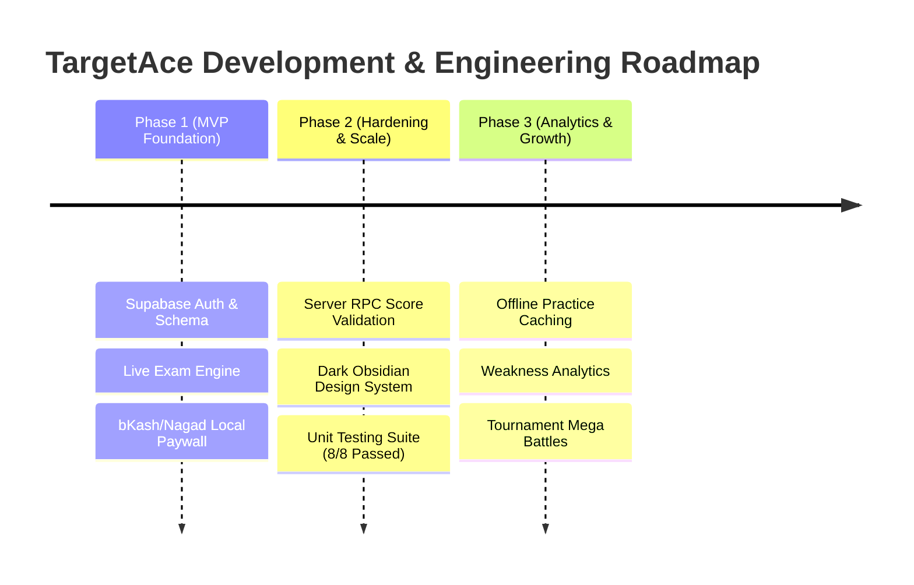

# TargetAce: Project Vision, Scope & Product Requirements (PRD)

---

## 📌 1. Executive Summary & Vision

**TargetAce** is an enterprise-grade, real-time competitive examination and practice platform designed specifically for students in Bangladesh preparing for national competitive exams (e.g., BCS, Bank Jobs, Primary Teacher Recruitment) and higher secondary/university admission tests (e.g., Medical, BUET, DU Admission).

The platform transforms passive study into a high-stakes, gamified "Live Battle Arena" where thousands of candidates compete simultaneously under strict anti-cheat and synchronized timing constraints.

| Attribute | Details |
| :--- | :--- |
| **Project Name** | TargetAce: Live Battle Exams |
| **Version** | 1.0 (Production Release) |
| **Primary Platform** | Android (Student Client - Flutter), Web (Admin Control Panel) |
| **Core Architecture** | Flutter Clean Architecture + BLoC/Cubit + Supabase Backend |
| **Target Audience** | BCS Candidates (46th/47th), University Admission Seekers, HSC Students |
| **Monetization** | Freemium Micro-Subscription (bKash & Nagad Local Mobile Financial Services) |

---

## 🎯 2. Problem Statement & Value Proposition

### The Problems in Traditional Test Prep
1. **Monotony & Lack of Real Competition**: Static quiz apps only offer isolated self-testing without real-time peer pressure or time-bound stress.
2. **Online Test Frauds & Cheating**: Most online test portals lack anti-cheat mechanisms, allowing candidates to switch apps, search answers, or fake scores.
3. **Payment Barriers**: Bangladeshi students lack international credit cards to purchase online subscriptions.
4. **Generic Test Platforms**: Generic apps do not segment students by exact targets (e.g., a BCS candidate competing against a university admission student yields meaningless rankings).

### TargetAce Core Solutions
- **Segmented Target Niche Zones**: Dedicated competitive environments per target goal (`BCS`, `DU Admission`, `HSC Science`).
- **Synchronized Live Battle Engine**: All candidates in a niche start and finish tests at the exact same second (e.g., 9:00 PM Live Battle).
- **Anti-Cheat Hardening**: App lifecycle tracking automatically disqualifies candidates who minimize or background the Flutter app.
- **Server-Side RPC Score Validation**: PostgreSQL RPC (`submit_battle_exam_secure`) calculates scores authoritatively from database answer keys, nullifying client-side tampering.
- **Local Mobile Financial Services (MFS)**: Native bKash and Nagad payment review flow with instant WhatsApp support routing.

---

## 👤 3. Target User Personas

### Persona 1: Rahat (BCS Aspirant)
- **Age**: 25 | **Location**: Dhaka | **Goal**: 47th BCS Preliminary
- **Pain Point**: Studies 8–10 hours daily but cannot gauge his relative ranking against 300,000+ competitors nationwide.
- **Needs**: A 9:00 PM daily full-length live battle exam with instant nationwide ranking, group ranking, and detailed solution explanations.

### Persona 2: Sadia (HSC & Admission Candidate)
- **Age**: 18 | **Location**: Chittagong | **Goal**: Engineering Admission
- **Pain Point**: Gets bored practicing textbook MCQs alone at home.
- **Needs**: Subject-wise and topic-wise daily micro-quizzes with gamified XP, streaks, and a 3D podium for top performers.

---

## 🗺️ 4. Feature Roadmap & Milestone Matrix

### Module Milestone Details

| Module | Feature ID | Feature Name | Priority | Status | Description |
| :--- | :--- | :--- | :--- | :--- | :--- |
| **Auth** | `F-AUTH-01` | Supabase Auth & Session | `P0` | ✅ Completed | Email/Password & Anonymous Auth, persistent local session. |
| **Battle** | `F-BAT-01` | Live Battle Engine | `P0` | ✅ Completed | Synchronized waiting room, live exam, auto-submit on timeout. |
| **Battle** | `F-BAT-02` | Server RPC Security | `P0` | ✅ Completed | `submit_battle_exam_secure` PostgreSQL RPC for anti-tamper score calculation. |
| **Battle** | `F-BAT-03` | Anti-Cheat Telemetry | `P0` | ✅ Completed | Lifecycle monitoring; auto-disqualification on backgrounding. |
| **Battle** | `F-BAT-04` | 3D Podium & Leaderboards | `P0` | ✅ Completed | Top 3 rankers 3D podium, Group Rank & Global Rank via DB cache table. |
| **Practice**| `F-PRC-01` | Practice Hub & Topics | `P1` | ✅ Completed | Subject & topic practice, bookmarking, and error reporting sheet. |
| **Sub** | `F-SUB-01` | MFS BD Local Paywall | `P0` | ✅ Completed | bKash/Nagad manual TxID review flow, 7-day trial, status navigation. |
| **Design** | `F-UI-01` | Dark Obsidian System | `P1` | ✅ Completed | Strict `AppColors` palette and `AppFonts` typography standardization. |
| **Quality** | `F-QA-01` | Unit Tests & Analyzer | `P1` | ✅ Completed | 8/8 unit tests passing (`flutter test`), 0 linter errors (`flutter analyze`). |

---

## 📊 5. Key Metrics & Success KPIs

- **Active Battle Participation Rate**: >85% of active registered users participating in daily 9:00 PM live battles.
- **Cheating Disqualification Accuracy**: 100% of app-minimize events caught and logged with `disqualified: true`.
- **Server Score Validation Time**: `< 200 ms` execution time for `submit_battle_exam_secure` RPC.
- **Leaderboard Response Time**: `< 50 ms` read time for Top 50 rankers from `public.leaderboards` cache table.
